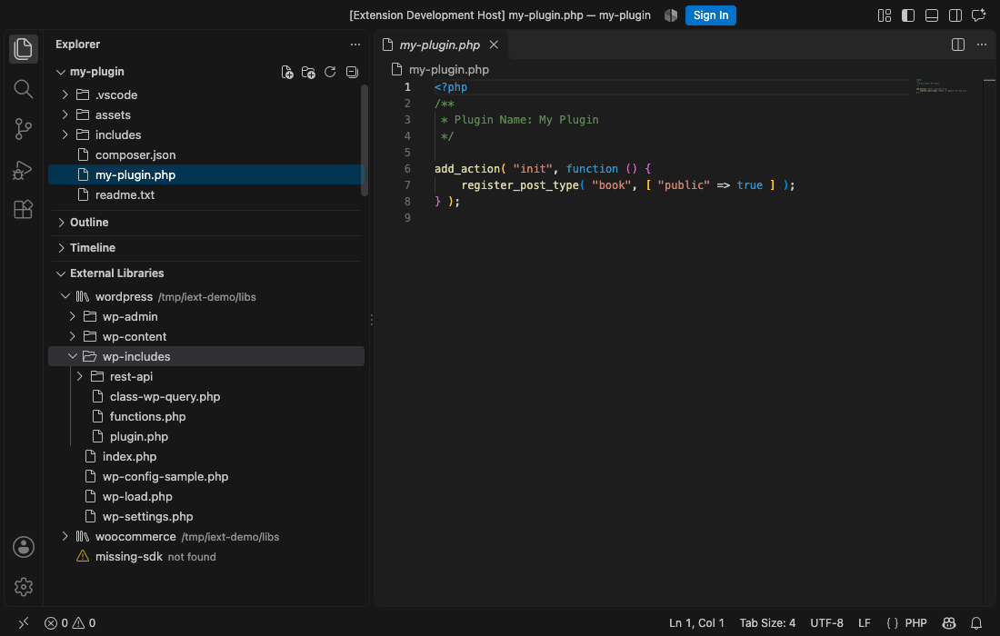

# iExternal libraries

PhpStorm's **External Libraries** for VS Code. Add folders that live outside your project — WordPress core,
WooCommerce, a shared plugin, an SDK, PHP stubs — as **include paths**: browse them in an *External Libraries* view
and let your PHP language server index them for completion, hover and *Go to Definition*. Nothing is copied or
linked into the project, so git and deployment never see them.



## Features

| PhpStorm | iExternal libraries |
|---|---|
| *Settings → PHP → Include Path* | `iextlibraries.includePaths` in the workspace settings |
| *External Libraries* node in the Project tool window | **External Libraries** view in the Explorer — browse, open files, reveal in Finder / Explorer, copy path |
| Include paths are indexed for code intelligence | Kept in sync with [Intelephense](https://marketplace.visualstudio.com/items?itemName=bmewburn.vscode-intelephense-client) (`intelephense.environment.includePaths`) |
| Nothing is added to the project | Nothing is added to the project |
| — | **Import from PhpStorm**: reads the include paths of `.idea/php.xml` |

## Getting started

1. Open the Explorer and expand **External Libraries**.
2. Click **+** (*Add External Library…*) and choose one or more folders, or type a path (`~/…`, absolute, or relative
   to the workspace folder).
3. Already using PhpStorm? Click **Import from PhpStorm** in the empty view (or in the view's `…` menu).

Right-click a library to **Remove** it (only the include path is removed — the files stay untouched), reveal it in the
file manager or copy its path. Missing folders are flagged as *not found*.

## Settings

| Setting | Default | Description |
|---|---|---|
| `iextlibraries.includePaths` | `[]` | The external library folders. Paths in your home folder are saved as `~/…`, so a committed `.vscode/settings.json` works for the whole team (like PhpStorm's `$USER_HOME$`). |
| `iextlibraries.intelephense.sync` | `true` | Mirror the libraries into `intelephense.environment.includePaths`. Entries you add to Intelephense yourself are kept. |

```json
{
  "iextlibraries.includePaths": ["~/code/wordpress", "~/code/woocommerce", "../shared-plugin"]
}
```

## Notes

- **Code intelligence** comes from your PHP language server. With Intelephense installed it is configured
  automatically. Other language servers can be pointed at the same folders through their own include-path setting.
- **Search** (`Cmd+Shift+F`) covers workspace folders only — like PhpStorm's default *Project Files* scope, libraries are
  not part of it. *Go to Symbol in Workspace* (`Cmd+T`) does find their classes and functions through Intelephense.
- Settings live in the workspace (`.vscode/settings.json`, or the `.code-workspace` file in multi-root workspaces).

## Development

```bash
npm install
npm test           # type-check (JSDoc + checkJs) and unit tests
npm run test:e2e   # end-to-end tests inside VS Code
npm run lint
npm run package    # iextlibraries-<version>.vsix
```

Press `F5` to try the extension in a new VS Code window.
